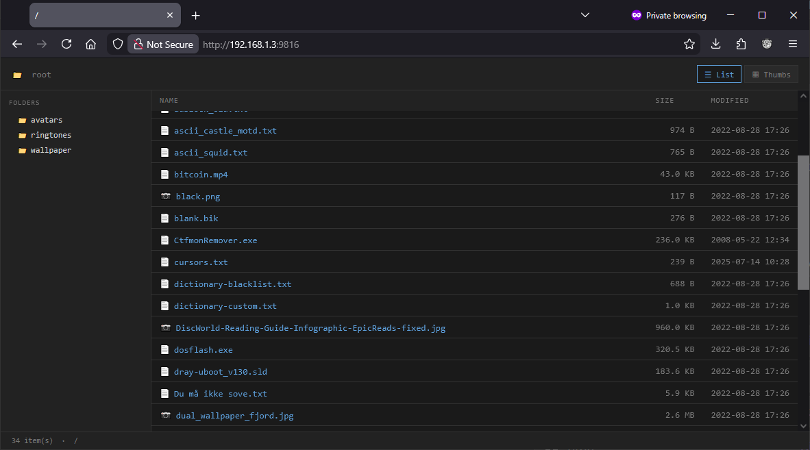

# Bruschetta

A simple golang web based file browser. Inspired by [h5ai](https://github.com/lrsjng/h5ai), but with fewer features and probably more bugs.

## Running

```
cd bruschetta
go run . -d ~/your/directory/ -p 8080
```

Then access the servers IP address via a web browser on port `8080`.

## Building

The application is also buildable via your usual `go build -o bruschetta .`.

## Features
* List and thumbnail views
* Filter current directory
* Thumbnails generated on the fly and cached
* Dotfiles are hidden, but still accessible
* Collapsable folder tree
* Sortable Name, Size and Modified columns
* No dependencies outside stdlib
* Renders `index.htm(l)` files in directories instead of listing

## Screenshot


